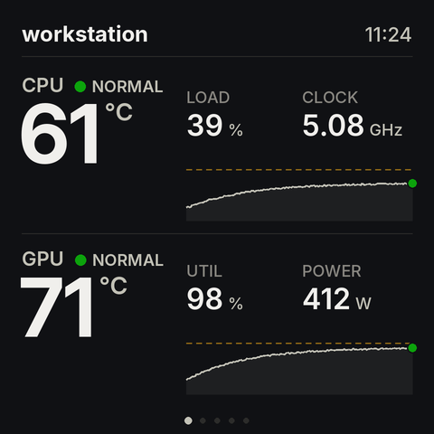
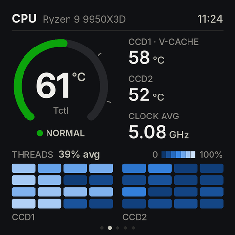
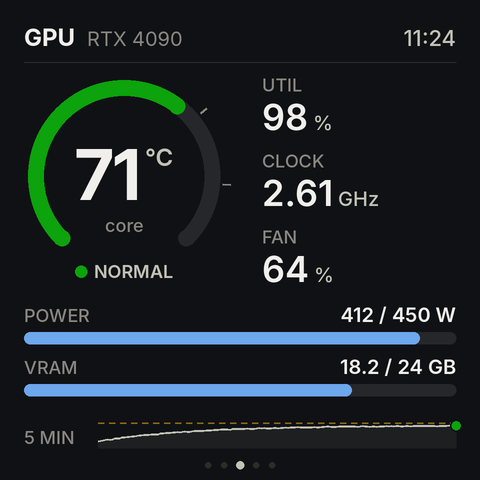
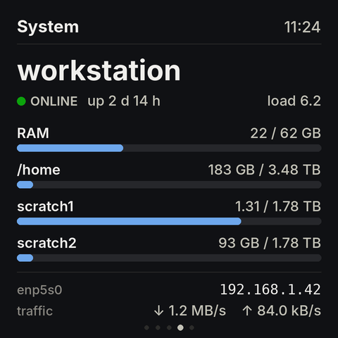
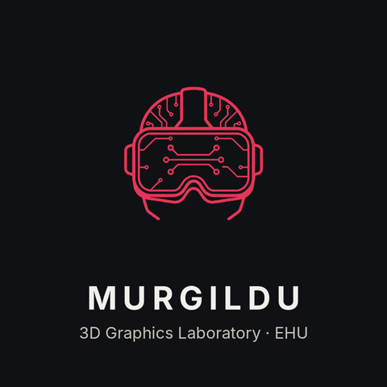
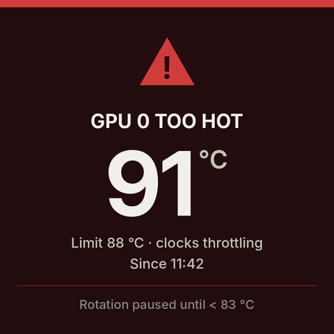
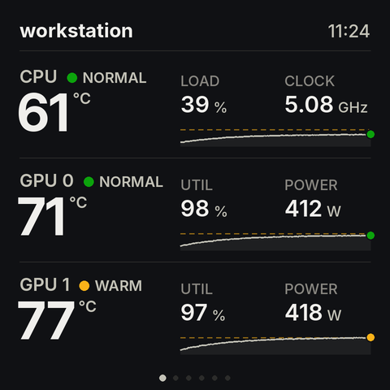
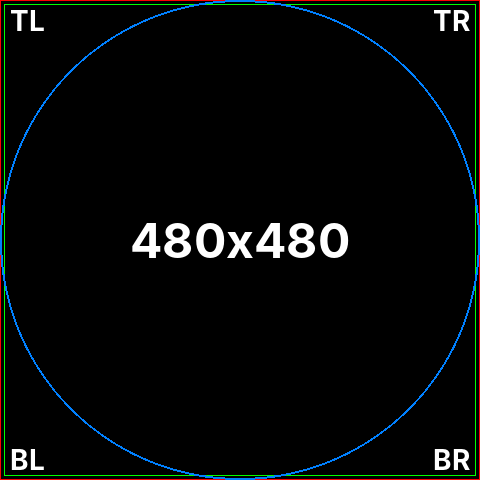
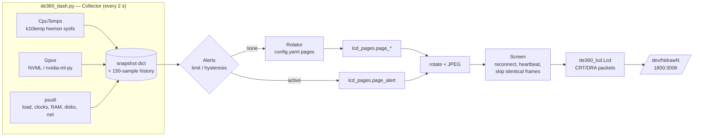
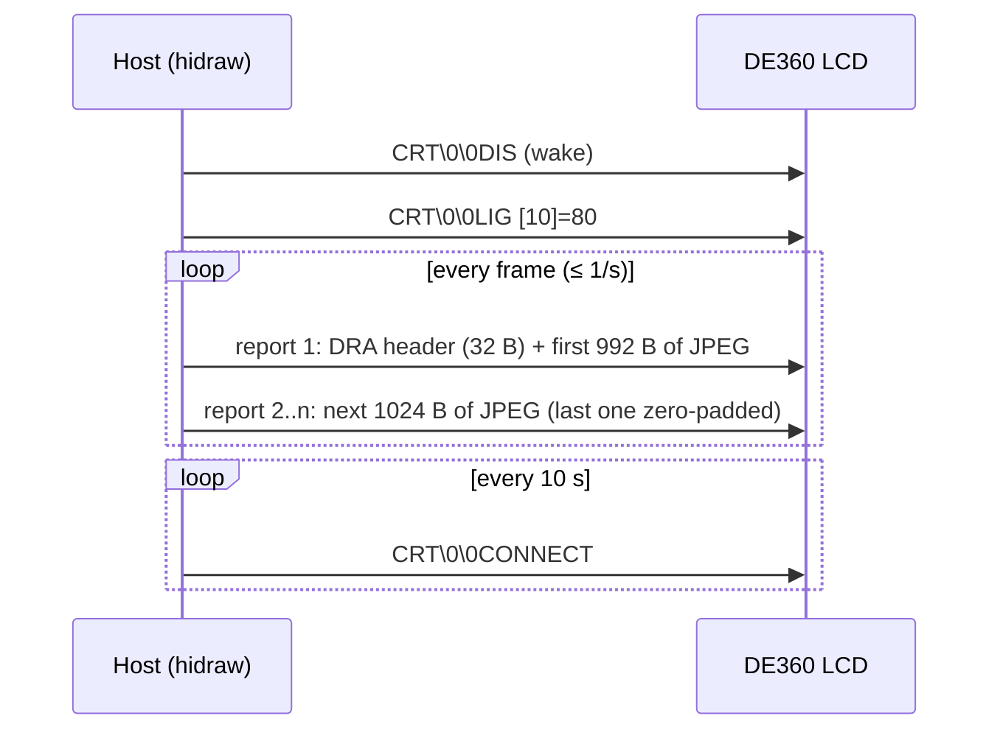

# de360-lcd — Linux driver and dashboard for the darkFlash DE240 / DE360 AIO LCD

The darkFlash DE240/DE360 all-in-one liquid coolers have a 480×480 LCD on the
pump head. The vendor software ("DF Space Station") only runs on Windows. This
project **reverse-engineers the USB protocol of the screen** from the Windows
installer and replaces the vendor app on Linux. It runs a small, low-CPU systemd
service that shows a rotating hardware dashboard (CPU, GPU, system) with an
over-temperature alert.

| Overview | CPU | GPU | System |
|---|---|---|---|
|  |  |  |  |
| **Logo splash** | **Alert (pinned)** | **Overview, 2 GPUs** | **Test pattern** |
|  |  |  |  |

*(Screens rendered from mock data with `tools/render_screens.py`; on the device they look the same.)*

---

## Contents

1. [Status and tested hardware](#1-status-and-tested-hardware)
2. [Quick start](#2-quick-start)
3. [What the dashboard shows](#3-what-the-dashboard-shows)
4. [Repository layout](#4-repository-layout)
5. [Architecture and modules](#5-architecture-and-modules)
6. [The USB protocol](#6-the-usb-protocol) (incl. [6.1 keep-alive](#61-keep-alive-the-screen-resets-when-frames-stop))
7. [How the protocol was reverse engineered](#7-how-the-protocol-was-reverse-engineered)
8. [Hardware checks that were done](#8-hardware-checks-that-were-done)
9. [Configuration reference](#9-configuration-reference)
10. [Development guide](#10-development-guide)
11. [Open questions / ideas](#11-open-questions--ideas)
12. [Legal notes](#12-legal-notes)

---

## 1. Status and tested hardware

| | |
|---|---|
| Screen | darkFlash DE360 pump LCD, USB `1800:3006` "HOTSPOTEKUSB HID DEMO", 480×480, square |
| Machine | ASUS ProArt X870E, AMD Ryzen 9 9950X3D, NVIDIA RTX 4090 |
| OS | Ubuntu 26.04 (server), kernel 7.0, Python 3.14 |
| Python libs | Pillow 12.1, PyYAML 6.0, psutil 7.2, nvidia-ml-py 13.x |
| GPU driver | NVIDIA 595 server-open (the project only *reads* it through NVML) |
| Vendor software analysed | DF Space Station 5.1.17 (`darkFlash_DE240-DE360_Driver.exe`, March 2026) |

Verified on the device: full-screen JPEG frames, rotation, the test pattern, the
whole rotating dashboard, and automatic reconnection (exercised by real firmware
resets, see [6.1](#61-keep-alive-the-screen-resets-when-frames-stop)). A 5-minute
all-core stress test was shown correctly (section 8). The alert override and its
hysteresis were tested with synthetic temperatures only: the tested machine's
cooler never lets Tctl get near the 92 °C limit. The DE240 uses the same software
and very probably the same protocol, but it has not been tested.

## 2. Quick start

```sh
git clone https://github.com/ilopezgazpio/Darkflash_DE360_linux.git
cd Darkflash_DE360_linux
sudo ./install.sh
```

`install.sh` does the following and nothing else:

* **apt**: `python3-venv python3-pil python3-yaml fonts-inter`. It never
  installs, removes or upgrades NVIDIA/CUDA/driver packages.
* Copies `src/*.py` to `/opt/de360-lcd/` and creates a venv there
  (`--system-site-packages`, so Pillow/PyYAML come from apt) with `psutil` and
  `nvidia-ml-py` from pip.
* Copies `config/config.yaml` and `assets/logo_lcd.png` to `/etc/de360-lcd/`
  if they are not there yet. **Your edited config is never overwritten.**
* Installs the udev rule (group `plugdev` may open the screen) and the
  `de360-lcd.service` unit, then enables and starts it.

Useful commands:

```sh
journalctl -u de360-lcd -f                       # live log
sudo nano /etc/de360-lcd/config.yaml && sudo systemctl restart de360-lcd
sudo ./uninstall.sh            # remove service + /opt; add --purge to drop /etc/de360-lcd
```

**Screen upside down or sideways?** Set `rotate:` (0/90/180/270) in the config
and restart.

**Check that the whole panel is visible.** Stop the service and send the test
pattern: you must see the red and green borders, the full blue circle, and
TL/TR/BL/BR in the corners.

```sh
sudo systemctl stop de360-lcd
/opt/de360-lcd/venv/bin/python -I /opt/de360-lcd/de360_dash.py --config /etc/de360-lcd/config.yaml --test-pattern
sudo systemctl start de360-lcd
```

**Offline install.** Put the `.deb` files (`apt-get download fonts-inter python3.X-venv
python3-pip-whl python3-setuptools-whl ...`) and the wheels
(`pip download -d deps -r requirements.txt`) into `./deps/` first. `install.sh`
then uses `dpkg -i deps/*.deb` and `pip --no-index --find-links deps`.

## 3. What the dashboard shows

| Page | Content |
|---|---|
| **overview** | One row per device (CPU, then every GPU): big temperature with a status word, two stats, 5-minute trend with the warning line |
| **cpu** | Tctl gauge, CCD1 (V-Cache) / CCD2 temperatures, average clock, 32-thread load heatmap split per chiplet |
| **gpu** | One page per GPU: core temperature gauge, utilisation, clock, fan, power vs. enforced limit, VRAM bar, 5-minute trend |
| **system** | Host name, uptime, load average, RAM and up to three disks (bars turn amber above 85 %), interface, IPv4, rx/tx rate |
| **logo** | Your logo plus a title and subtitle |
| **alert** | Shown instead of the rotation while any temperature is ≥ its limit; released when it drops `hysteresis` °C below the limit |

Design rules (from `lcd_pages.py`):

* At most about 6 values per page and nothing smaller than 18 px. The panel
  is about 52 mm wide.
* One status palette everywhere: green NORMAL, amber WARM, orange HIGH,
  red HOT. A status is always shown with a word, never with colour alone.
* Pages are drawn at 2× and downscaled with Lanczos, so arcs and text are smooth.

Resource use: the service reads the sensors every 2 s and sends at most 1 frame
per second. A 20 s test run (16 frames) used 0.24 CPU-seconds.

## 4. Repository layout

```
src/
  de360_lcd.py        USB/HID protocol (Lcd class) + a minimal standalone "CPU temp" mode
  lcd_pages.py        Page renderers: snapshot dict -> 480x480 PIL image (+ mock data)
  de360_dash.py       The service: collectors, history, alerts, rotator, screen I/O, CLI
config/config.yaml    Example/default configuration (installed to /etc/de360-lcd/)
assets/logo_lcd.png   Logo for the splash page (transparent PNG)
assets/logo_source.png  Original logo; tools/make_logo.py turns it into logo_lcd.png
systemd/              de360-lcd.service
udev/                 99-de360-lcd.rules
install.sh            Installer / upgrader (run with sudo)
uninstall.sh
requirements.txt      pip packages for the venv
tools/
  extract_installer.py  Unpack the Advanced Installer EXE (MSI + CAB) on Linux
  make_logo.py          White-background logo -> transparent PNG for the dark slide
  hw_probe.py           Measure the screen's limits: frame size, frame rate, silence timeout
  render_screens.py     Regenerate docs/screens/ from mock data
  re/                   Reverse-engineering helpers (see section 7)
    pe.py               Tiny PE32+ parser: sections, imports, exports, strings
    annotate.py         Annotate objdump output with referenced strings/imports
    vtable.py           Find a C++ class vtable through MSVC RTTI
    device_table.py     Dump the VID:PID -> device type table of the vendor app
    packets.py          Recover HID packet templates from SDLibrary1.dll
    find_string.py      Address of a string, to grep for code that uses it
docs/screens/         README images
```

## 5. Architecture and modules



### `src/de360_lcd.py` — protocol layer

* `find_hidraw()` scans `/sys/class/hidraw/*/device/uevent` for
  `HID_ID=0003:00001800:00003006` and returns `/dev/hidrawN`.
* `Lcd(path)` writes raw output reports with `os.write`. Methods: `command()`,
  `wake()`, `brightness()`, `heartbeat()`, `frame(jpeg)` and `drain()`. `drain()`
  reads and discards input reports so the device queue never fills.
* Running it directly (`python3 de360_lcd.py`) gives the first, minimal version
  of the project: a single CPU-temperature gauge from `sensors -j`. It is handy
  for protocol experiments.

### `src/lcd_pages.py` — drawing

Each page is a pure function `page_xxx(snap, hist, ...) -> PIL.Image` (RGB 480×480).
It knows nothing about USB or sensors. Constants at the top hold the geometry,
palette, thresholds, type scale and fonts (Inter, with DejaVu as fallback).
`python3 src/lcd_pages.py` renders every page from `mock()` into `./out/`.

**The snapshot schema is the contract between collectors and pages.** `mock()`
is the reference example:

```python
snap = {
  "time": "11:24", "host": "workstation", "uptime_s": 223620, "loadavg": [6.2, 5.8, 4.1],
  "cpu":  {"model": "Ryzen 9 9950X3D", "tctl": 61, "ccd": [58, 52],   # ccd[0] = Tccd1 = V-Cache
           "clock_ghz": 5.08, "load": 39.0, "threads": [32 floats, 0-100]},
  "gpus": [{"index": 0, "name": "RTX 4090", "temp": 71, "util": 98, "power": 412,
            "power_limit": 450, "vram_used": 18.2, "vram_total": 24.0, "fan": 64,
            "clock_ghz": 2.61, "throttling": False}],
  "mem":  {"used": 21.6, "total": 62.0},                                # GiB
  "disks": [{"label": "/home", "used_gb": 183, "total_gb": 3480}, ...], # GB (1e9)
  "net":  {"iface": "enp5s0", "ip": "192.168.1.42", "rx_bps": 1.24e6, "tx_bps": 8.4e4},
}
hist = {"cpu_temp": [...], "gpu0_temp": [...]}   # up to 150 samples each, oldest first
```

### `src/de360_dash.py` — the service

| Part | What it does |
|---|---|
| `CpuTemps` | Finds the `k10temp` hwmon directory once and reads `Tctl`, `Tccd1`, `Tccd2` from the same sysfs files lm-sensors uses, without spawning a process. It searches again if the files disappear. |
| `Gpus` | Loads NVML lazily. If it fails (no driver, no GPU) the dashboard runs without GPUs and retries every 60 s. Reads temperature, utilisation, power and enforced limit, VRAM, fan, graphics clock and clock-event reasons. `throttling` is true for HW/SW thermal slowdown or power brake. |
| `Collector.sample()` | Builds the snapshot (psutil: per-thread `cpu_percent`, `cpu_freq`, memory, `disk_usage`, net counters of the default-route interface) and appends to the `deque(maxlen=150)` histories. |
| `Alerts` | Latches an alert at `value >= limit` and clears it at `value < limit - hysteresis`. If several alerts are active it shows the one furthest over its limit, with the time it started. |
| `expand_pages` / `render` | Turn the `pages:` list into concrete pages (`gpu` becomes one page per GPU) and call the matching `lcd_pages` function with the page index for the dots. |
| `Screen` | Opens the device lazily and sends wake + brightness on connect. Sends a `CONNECT` heartbeat every 10 s. Skips a byte-identical frame only if the last one went out less than `max_frame_gap` s ago, because the firmware resets after about 8 s without frames (6.1). On any `OSError` it closes the device and reconnects on the next frame. |
| `run()` | A single event loop: sample when due, advance the page when due (unless an alert is pinned), render when something changed but at most once per `min_frame_interval`, then sleep until the next event. |
| CLI | `--config`, `--preview DIR` (render all pages from live sensors to PNG, no device needed), `--test-pattern`, `-v`. |

### systemd unit

`DynamicUser=yes` + `SupplementaryGroups=plugdev` (no root, no fixed user),
`ProtectSystem=strict`, `ProtectHome=read-only` (so `/home` usage can be read),
`NoNewPrivileges`, `Nice=10`, `Restart=on-failure`. Network is **not**
isolated, because the system page reads interface addresses and counters.

## 6. The USB protocol

The screen is a USB HID device with one vendor-defined interface:

* Usage page `0xFFA0`, **no report IDs**.
* One 512-byte input report and one 1024-byte output report.
* On Linux every write to `/dev/hidrawN` is `b"\x00" + 1024 bytes`. The leading
  0 is the report ID that the kernel strips.

The vendor library is MiraBox's "StreamDock" SDK, so the protocol is the
MiraBox **"CRT"** protocol. Byte offsets below are *within the 1024-byte report*
(report ID not counted). Unused bytes are 0.

### Commands used by this project

| Bytes 0..7 | Arguments | Meaning |
|---|---|---|
| `CRT\0\0DIS` | `[10] = 1` | Wake the screen |
| `CRT\0\0LIG` | `[10] = 0..100` | Brightness |
| `CRT\0\0CONNECT` | — | Heartbeat / keep-alive |
| `CRT\0\0DRA` | see below | Frame header ("draw") |

### Frame = 32-byte DRA header + JPEG, cut into 1024-byte reports

| Offset | Size | Value |
|---|---|---|
| 0 | 8 | `CRT\0\0DRA` |
| 8 | 4 | total length = 32 + len(jpeg), big-endian |
| 12 | 1 | key = `0xB1` (the value the app uses for the DE screen) |
| 13 | 2 | width, BE — 0 for a full-screen frame |
| 15 | 2 | height, BE — 0 |
| 17 | 2 | x, BE — 0 |
| 19 | 2 | y, BE — 0 |
| 21..31 | | 0 |

The header and the JPEG are **concatenated**, then sent as consecutive 1024-byte
reports. The last report is zero-padded. The JPEG is baseline, 480×480. The
vendor app uses quality 70; we use 80, and a frame is about 17–28 KB. The DE
path does not wait for an acknowledgement.

Measured limits (with `tools/hw_probe.py`): frames of 21–61 KB and rates up to
10 frames/s were all accepted without a single error.



Minimal example:

```python
import os, struct
fd = os.open("/dev/hidraw4", os.O_RDWR)
jpeg = open("frame480.jpg", "rb").read()
data = (b"CRT\0\0DRA" + struct.pack(">IB", 32 + len(jpeg), 0xB1)).ljust(32, b"\0") + jpeg
for i in range(0, len(data), 1024):
    os.write(fd, b"\0" + data[i:i + 1024].ljust(1024, b"\0"))
```

### Other commands found in SDLibrary1.dll (not used here, untested on the DE)

From `tools/re/packets.py`. These come from the generic StreamDock code, and
the DE screen may ignore some of them.

| Command | Arguments (report offsets) | SDK function |
|---|---|---|
| `CRT\0\0HAN` | `[10]=1` | `addScreenOffPack` (screen off) |
| `CRT\0\0CLE` | `[11]=key`, `0xFF` = all | `addClearCommand` / `addClearAllCommand` |
| `CRT\0\0CLE` | `[10]='D' [11]='C'` | `sendDisconnectCommand` |
| `CRT\0\0STP` | `[9]=0x21` | `addFinishCommand` (flush/refresh on StreamDocks) |
| `CRT\0\0BAT` | size + key | `sendPicSizeCommand` (key images on StreamDocks) |
| `CRT\0\0LOG` | size + key | `sendLogoSizeCommand` (boot logo upload) |
| `CRT\0\0VER` | — | `sendGetHardwareFirmwareVersion` |
| `CRT\0\0MOD` | `[10]=mode` | `addModeChangedCommand` |
| `CRT\0\0SET` | two bytes | `sendChangeDirectionCommand` |
| `CRT\0\0QUCMD` | 5 bytes | `addQUCMDCommand` |
| `CRT\0\0KEY` | key list | keyboard down/up emulation |
| `CRT\0\0ULEND` | — | `getUploadFinishedCommand` |
| `HAN` (no CRT) | — | handshake, only for "StreamDock[296]" |

### 6.1 Keep-alive: the screen resets when frames stop

**The firmware drops off USB and re-enumerates if it receives no frame for about
8–11 s.** The `CONNECT` heartbeat does *not* reset this timer; only frames do.
The vendor app streams continuously, so it never hits this. Measured with
`tools/hw_probe.py gap`: 8 s of silence was survived, 10 s caused a reset, and
in one dashboard trace the reset came 8.1 s after the last frame.

Symptoms: `usb 3-7: USB disconnect` / `new high-speed USB device` in
`journalctl -k`, the screen blanks for about 4 s, and the service logs
`[Errno 19] No such device`, `[Errno 5] Input/output error` or
`[Errno 108] Cannot send after transport endpoint shutdown`.

The first dashboard version skipped byte-identical frames. On pages whose content
did not change (the GPU page with an idle GPU, the logo page) it therefore went
quiet, and the screen reset about once per rotation. The fix is in `Screen.send()`:
an identical frame is skipped only if the last frame went out less than
`max_frame_gap` (1.5 s) ago, so with 2 s sampling a frame goes out at least every
2–3 s. A 4-minute verification run had 0 resets (previously about 1 per minute).

How it was found: the resets were periodic with the page rotation, so the first
suspects were frame size and frame rate. Probes ruled out both (61 KB frames and
10 fps both work). Every page sent on its own also worked. Running the real loop
with a per-packet trace then showed the reset arriving 8 s after the last frame,
with nothing being written at that moment.

It follows that the screen also resets about 10 s after the service stops. That
is harmless: the next writer simply reopens it.

## 7. How the protocol was reverse engineered

Everything was done on Linux with `7z`, `objdump` (binutils) and the small Python
helpers in `tools/`. No Windows, no USB sniffing, no decompiler. The vendor files
are **not** in this repository; to repeat the analysis, download the official
installer from darkFlash.

### 7.1 Unpacking the installer

`darkFlash_DE240-DE360_Driver.exe` (about 600 MB) is **not** NSIS. Its version
resource says "DF Space Station Installer". `7z` only opens the PE stub, and
the MSI strings name *Caphyon Advanced Installer*. The payload sits after the
stub and is described by a table at the end of the file, just before an
`ADVINSTSFX` magic and the Authenticode certificate:

```
footer (counted back from "ADVINSTSFX"):  -0x38 u32 file count, -0x2c u32 table offset
table entry: u32 ?, u32 ?, u32 flags, u32 size, u32 offset, u32 name_len, UTF-16 name
flags & 2 -> first 0x200 bytes XOR 0xFF
```

```sh
python3 tools/extract_installer.py darkFlash_DE240-DE360_Driver.exe vendor/payload
7z x -ovendor/cab vendor/payload/DF-Space-Station-Installer_Windows1.cab   # 1908 files
```

### 7.2 What kind of application it is

The CAB contains `Qt5*.dll`, `QtWebEngineProcess.exe`, QML files, `DFSpaceStation.exe`
(x86-64) and `SDLibrary1.dll`. There is no `*.asar` and no CLR header, so it
is **neither Electron nor .NET**. It is a **native C++ Qt5/QML app** built on
MiraBox's StreamDock SDK. The helper `app.exe` files are Node.js-based plugin
hosts, not the device code. `SDLibrary1.dll` has hidapi statically linked
(its `hid_init`/`hid_write`/... strings are inside, and it imports SETUPAPI and
WINUSB). Its log strings (`SDDevice::openHidDevice`, `writeDataToHidDevice`, ...)
show it does the USB I/O.

### 7.3 Which code drives our screen

The app keeps a table of `{type name, VID, PID}`. `tools/re/device_table.py`
dumps it (34 entries). The darkFlash VID `0x1800` entries are:

```
1800:3006  DE        <- our screen
1800:3007  Lite
1800:3008  DVS_MAX
1800:3012  D92
```

Each type has a C++ class `<type>DeviceOperation` (RTTI `.?AVDEDeviceOperation@@`).

### 7.4 What `DEDeviceOperation` does differently

`tools/re/vtable.py` finds the vtable through the RTTI Complete Object Locator.
Comparing it with its siblings (`D92DeviceOperation`, `ZY66DeviceOperation`)
shows which slots the DE class overrides (99, 100, 102, 143–145). The
constructor fixes the screen size:

```asm
14003a1e9: call   0x14002d690                     ; base-class ctor
14003a1ee: lea    rax,[rip+...]  # 0x1461f9400    ; DEDeviceOperation vtable
14003a1f5: mov    DWORD PTR [rbx+0x20c],0x32      ; 50   (frame interval? see section 11)
14003a205: mov    DWORD PTR [rbx+0x210],0x1388    ; 5000 (unknown)
14003a20f: mov    DWORD PTR [rbx+0x200],0x1e0     ; width  480
14003a219: mov    DWORD PTR [rbx+0x204],0x1e0     ; height 480
```

The frame method (slot 99) rotates the image grabbed from the QML page and then
builds an `ImageStruct`:

```asm
140030747: mov    DWORD PTR [rdi],0x10            ; type 0x10 = secondary-screen picture
140030765: mov    r9d,0x46                        ; JPEG quality 70
14003076b: lea    r8,[rip+...]   ;; 'JPG'
14003077a: call   DataFormatConversion::QImageToQByteArray
140030798: mov    DWORD PTR [rdi+0x2c],0xb1       ; key 0xB1
...
14003a2df: call   QWORD PTR [rax+0x138]           ; SDDevice::appendSendData(ImageStruct, false)
```

The `ImageStruct` constructor leaves the rect empty (x=y=w=h=0) and the
"wait for ack" byte at offset 4 at 0. The slot number 0x138 was resolved by
dumping the exported `SDDevice` vtable from `SDLibrary1.dll`.

### 7.5 How SDLibrary turns that into USB reports

`SDDevice::writeDataToHidDevice` (the writer thread) does this for types
0x10–0x13 (except 0x11):

1. Calls `getSecondaryScreenPicInfo(ImageStruct)` and **prepends** the result to
   the JPEG bytes.
2. Loops over the buffer in steps of the output report length. Each step copies
   one chunk into a `reportLen + 1` buffer and zero-pads the last one. Byte 0
   is set to the report ID (0), then it calls `writeData()`.

`getSecondaryScreenPicInfo` builds the 32-byte header byte by byte; one field
at a time:

```asm
mov r8d,0x5 ; mov dl,0x44  -> [5]='D'   ... [6]='R', [7]='A'
mov edi,[size]; add edi,0x20                     -> total = len(jpeg) + 32
sar ebx,0x18 -> [8] ; sar 0x10 -> [9] ; sar 0x8 -> [10] ; edi -> [11]   (big-endian)
movzx edx,BYTE PTR [r14+0x2c] -> [12]            -> key 0xB1
QRect::width -> [13..14], height -> [15..16], x -> [17..18], y -> [19..20]
```

Because the vendor builds every packet this way (`QByteArray[idx] = value`),
`tools/re/packets.py` can print the template of every command just by pattern
matching `mov r8d,idx` / `mov dl,val`. That produced the command tables in
section 6.

### 7.6 Reproducing the analysis

```sh
objdump -d --no-show-raw-insn -M intel vendor/cab/DFSpaceStation.exe > dfs.asm
objdump -d --no-show-raw-insn -M intel vendor/cab/SDLibrary1.dll   > sdl.asm
cd tools/re
python3 device_table.py ../../vendor/cab/DFSpaceStation.exe ../../dfs.asm      # VID/PID -> type
python3 vtable.py ../../vendor/cab/DFSpaceStation.exe DEDeviceOperation         # overridden slots
python3 vtable.py ../../vendor/cab/SDLibrary1.dll SDDevice                      # slot -> method name
python3 annotate.py ../../vendor/cab/DFSpaceStation.exe ../../dfs.asm 0x14003a1e0 0x14003a330
python3 packets.py ../../vendor/cab/SDLibrary1.dll ../../sdl.asm | grep -A1 @SDDevice@@
python3 find_string.py ../../vendor/cab/DFSpaceStation.exe settingDevicePowerOnLogo
```

The addresses above are for DF Space Station **5.1.17**; other versions move
them, but the method is the same: string → code that uses it → vtable slot.

## 8. Hardware checks that were done

* **Panel resolution.** The binary says 480×480. `--test-pattern` (1-px red
  border, green inset border, inscribed circle, corner labels) showed the
  **full square with all four edges and corners visible**. The panel is not
  round, and nothing is cropped.
* **Which CCD has the 3D V-Cache (Ryzen 9 9950X3D).** sysfs shows 96 MB L3
  shared by CPUs `0-7,16-23` (`/sys/devices/system/cpu/cpu0/cache/index3`).
  Pinning a busy loop to cores 0–7 raised **Tccd1** from 27 to 72 °C, while
  Tccd2 stayed at 37 °C. Loading cores 8–15 did the opposite. So `Tccd1` is
  the V-Cache CCD, and the CPU page's heatmap (CCD1 = threads 0–7 + 16–23)
  matches.
* **Tctl vs. btop.** Tctl reads about 10 °C above the CCD sensors at idle. That
  is expected: it is AMD's control temperature, and it also reflects the I/O
  die. btop shows the per-CCD values. The dashboard shows Tctl as the main
  number and both CCDs on the CPU page.
* **Orientation.** On the tested pump the image needed `rotate: 180`.
* **Readings under load.** `stress-ng --cpu 32 --cpu-method matrixprod` for
  5 minutes: Tctl rose from 39 to 74 °C (Tccd1 72, Tccd2 74) and held all
  cores at 5.12 GHz without throttling. It was back under 45 °C 20 s after the
  load stopped. The dashboard showed the same values as `sensors`.

## 9. Configuration reference

`/etc/de360-lcd/config.yaml` (relative paths are resolved next to the config file):

| Key | Default | Meaning |
|---|---|---|
| `sample_interval` | 2 | Seconds between sensor reads |
| `history` | 150 | Samples kept per temperature (150 × 2 s = 5 min) |
| `min_frame_interval` | 1 | Lower bound between frames (≤ 1 fps) |
| `max_frame_gap` | 1.5 | Resend an unchanged frame after this many seconds; keep well below the ~8 s firmware timeout ([6.1](#61-keep-alive-the-screen-resets-when-frames-stop)) |
| `brightness` | 80 | 0–100, sent on connect |
| `rotate` | 180 | 0/90/180/270, applied to every frame |
| `jpeg_quality` | 80 | JPEG quality of frames |
| `pages` | see file | Ordered list of `{page, seconds}`; pages: `overview`, `cpu`, `gpu` (expands per GPU), `system`, `logo` |
| `logo`, `logo_title`, `logo_subtitle` | lab logo | Splash page content. Make a logo with `tools/make_logo.py` |
| `thresholds.cpu` / `.gpu` | `[75,85,92]` / `[75,83,88]` | °C for WARM / HIGH / HOT colours and gauge ticks |
| `alert.cpu_limit` / `.gpu_limit` | 92 / 88 | Alert when ≥ limit (default: the HOT threshold) |
| `alert.hysteresis` | 5 | Alert clears below `limit - hysteresis` |
| `disks` | `/home`, `/scratch1`, `/scratch2` | Up to three `{label, path}` shown on the system page |
| `net_iface` | `auto` | Interface for IP/traffic; `auto` = default route |

## 10. Development guide

```sh
# dev environment (no root needed; Pillow/PyYAML from apt)
python3 -m venv --system-site-packages venv && venv/bin/pip install -r requirements.txt

python3 src/lcd_pages.py                                   # mock data -> ./out/*.png
venv/bin/python src/de360_dash.py --preview /tmp/prev      # live sensors -> PNGs, no device
python3 tools/render_screens.py                            # refresh README screenshots

# talk to the real screen: stop the service first, two writers garble frames
sudo systemctl stop de360-lcd
venv/bin/python src/de360_dash.py -v                       # uses config/config.yaml
venv/bin/python src/de360_dash.py --test-pattern
```

Your user needs access to `/dev/hidraw*` of the screen (`install.sh` adds the
udev rule for group `plugdev`).

**Add a metric.** Read it in `Collector.sample()` and put it in the snapshot.
If it needs a trend, call `self._push("key", value)`. Then add it to `mock()`
so the pages can be developed without hardware.

**Add a page.** Write `page_foo(snap, hist, page_idx=None, page_count=None)` in
`lcd_pages.py` using the helpers (`new_canvas`, `header`, `stat`, `bar`,
`arc_gauge`, `sparkline`, `status_pill`, `finish`). Then add a branch in
`de360_dash.render()` and list `{page: foo, seconds: N}` in the config. Keep to
the type scale and status palette at the top of `lcd_pages.py`.

**Support another darkFlash/MiraBox screen.**
1. Find its VID:PID in the `device_table.py` output.
2. Dump its `<type>DeviceOperation` vtable, diff it against `DEDeviceOperation`,
   and read the constructor (size at `+0x200/+0x204`) and the frame method
   (`ImageStruct` type, key and quality).
3. If it uses type 0x10 with another key or size, generalise `Lcd.frame()` and
   `W/H` in `lcd_pages.py`.

**Debugging.** `-v` logs every input report the screen sends (`in: ...`). The
service log is `journalctl -u de360-lcd`, and `journalctl -k | grep 'usb .*disconnect'`
shows firmware resets. A frame that never appears usually means another process
holds the device, or the header length is wrong. Periodic resets mean frames
stopped for about 8 s or more (section 6.1).

**Hardware probes** (`tools/hw_probe.py`, service stopped):
`size` sends frames from 20 to 60 KB, `rate` streams at decreasing intervals
down to 0.1 s, and `gap` goes silent for increasing times. Each reports whether
the screen survived.

## 11. Open questions / ideas

* The DE constructor sets `+0x20c = 50` and `+0x210 = 5000`; their meaning is
  unknown (frame interval in ms? timeout?).
* The 512-byte input reports were never observed or decoded. `-v` logs any
  that arrive.
* `CONNECT` does not keep the DE alive (6.1). Whether it is needed at all,
  and whether `LIG` changes the backlight, has not been isolated. Both are sent
  and harmless.
* The silence timeout may be related to the DE constructor values above
  (`5000` ms plus re-enumeration time?). Unconfirmed.
* The boot logo upload (`settingDevicePowerOnLogo`, `LOG` command, JPEG q95)
  could allow a custom power-on image. Not implemented.
* Partial updates (non-zero x/y/w/h in the DRA header) might allow cheaper
  frames. Not tested.
* The DE240 should work as is; reports welcome.

## 12. Legal notes

This project contains no vendor code, binaries or assets. The protocol was
derived by analysing the publicly downloadable Windows installer for the purpose
of interoperability on Linux. `.gitignore` blocks `*.exe/*.dll/*.cab/*.msi/*.asm`
so they are not committed by accident. darkFlash, MiraBox and other names are
trademarks of their owners; this project is not affiliated with them.

Licensed under the MIT License (see `LICENSE`).
